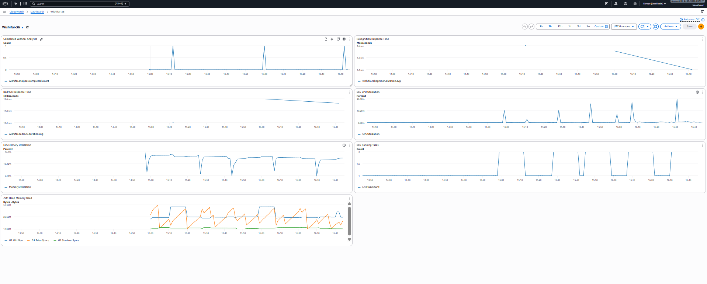

Oppgave 1 – Container og CI

1A – Containerisering med Docker

Jeg har laget en multi-stage Dockerfile for å kunne bygge og kjøre Spring Boot-applikasjonen i en container.

Dockerfilen er delt inn i to steg. Først brukes Maven med Java 21 til å bygge prosjektet og lage JAR-filen. Deretter kopieres JAR-filen over til et eget Java 21 JRE-image, som brukes til å starte applikasjonen. Grunnen til at jeg har valgt denne løsningen, er at vi slipper å ta med Maven og resten av byggemiljøet når applikasjonen skal kjøre. Det holder imaget enklere og unngår unødvendige filer.

Applikasjonen lytter på port 8080 inne i containeren. Jeg bygget imaget lokalt med:

docker build -t wishifai:local .

For å teste at containeren faktisk startet som den skulle, kjørte jeg:

docker run --rm -p 9999:8080 wishifai:local

Da kunne jeg nå applikasjonen gjennom port 9999 på maskinen min. Jeg sjekket også /actuator/health, som svarte med HTTP 200 og status UP. Det bekreftet at Spring Boot-applikasjonen startet riktig i Docker.

1B – CI-pipeline og ECR

For å slippe å bygge og laste opp Docker-imaget manuelt hver gang jeg gjør endringer, har jeg satt opp en GitHub Actions-workflow som håndterer dette.

Workflowen starter når jeg pusher endringer til main. Den bygger Docker-imaget og publiserer det til Amazon ECR. Jeg har valgt å bruke både Git commit SHA og latest som image-tagger.

SHA-taggen gjør det mulig å finne igjen nøyaktig hvilken versjon av koden som ligger bak et image. Det er spesielt nyttig når en ny deploy ikke fungerer som forventet, siden man da kan finne tilbake til en tidligere versjon. Latest gjør det samtidig enkelt å referere til den nyeste bygde versjonen.

AWS-nøklene ligger som GitHub Secrets (AWS_ACCESS_KEY_ID og AWS_SECRET_ACCESS_KEY). På den måten trenger jeg ikke å legge credentials direkte inn i workflow-filen eller GitHub-repositoriet.

Jeg kan følge byggingene og deployene her:

https://github.com/IsacRahman/eksamen-2026-kandidat-36/actions

Her er siste vellykede GitHub Actions-kjøring av den endelig versjonen:

https://github.com/IsacRahman/eksamen-2026-kandidat-36/actions/runs/42662236202

Oppgave 2 – ECS Express og Terraform

2A – Infrastruktur som kode

Jeg har brukt Terraform til å sette opp og vedlikeholde infrastrukturen for Wishifai. Terraform-filene ligger i infra/, slik at infrastrukturen kan opprettes og endres gjennom kode i stedet for å måtte konfigureres manuelt i AWS-konsollen.

Det som settes opp, er blant annet en ECS Express Gateway Service for Spring Boot-applikasjonen, en S3-bucket for bildene som lastes opp, og en egen IAM task role. Task-rollen gir applikasjonen tilgangene den trenger til S3, Rekognition og Bedrock. I tillegg bruker løsningen execution- og infrastructure-rollene som var oppgitt i eksamensbeskrivelsen.

Jeg har lagt inn variabler for blant annet AWS-region, kandidatnummer og image-tag. S3-bucketens navn sendes videre til applikasjonen gjennom miljøvariabelen S3_BUCKET. Det gjør at applikasjonen kan bruke riktig bucket uten at navnet må ligge hardkodet i koden.

Selve applikasjonen kjører i eu-north-1. Jeg måtte imidlertid bruke eu-west-1 for Rekognition-klienten, fordi Rekognition ikke er tilgjengelig i applikasjonsregionen. Dette er derfor håndtert separat i AWS-konfigurasjonen.

Den deployede tjenesten er tilgjengelig her:

https://wi-b3524b94d0974a249c6e9116e3f45ef4.ecs.eu-north-1.on.aws

Jeg testet tjenesten etter deploy, ikke bare ved å sjekke at ECS viste en kjørende oppgave. Health-endpointet svarte med HTTP 200 og UP, og jeg testet også /api/analyze med et faktisk bilde. Forespørselen gikk gjennom hele behandlingen: Bildet ble lagret i S3, Rekognition fant objekter og genererte labels, og Bedrock brukte informasjonen til å lage fem gaveforslag med begrunnelser.

Rotadressen (/) viser en Whitelabel 404-side. Det er forventet, siden jeg har laget en REST API og ikke en egen nettside med en forside. Det er API-endepunktene som er ment å brukes.

2B – Remote state

Jeg har konfigurert Terraform til å lagre state-filen i S3-bucketen pgr301-terraform-state, i stedet for å ha den liggende lokalt i prosjektet.

For mitt prosjekt brukes denne nøkkelen:

wishifai/36/terraform.tfstate

Det betyr at Terraform kan hente den samme state-filen fra ulike arbeidsmiljøer. Det er særlig nyttig når man jobber sammen med andre, fordi alle da tar utgangspunkt i samme oversikt over infrastrukturen. Det reduserer også risikoen for at lokale state-filer kommer ut av synk med det som faktisk finnes i AWS.

2C – Terraform gjennom GitHub Actions

Jeg har også koblet Terraform inn i GitHub Actions, slik at en push til main kan ta seg av både bygging og deploy.

Workflowen er delt opp i to jobber. Den første heter build-and-push og bygger imaget før det publiseres til ECR. Den andre heter terraform-deploy og oppdaterer infrastrukturen med Terraform.

Her er rekkefølgen viktig. Jeg har brukt needs: build-and-push på Terraform-jobben. Det gjør at deploy-jobben venter til imaget faktisk er publisert. Hvis begge jobbene hadde startet samtidig, kunne Terraform ha forsøkt å hente en image-versjon som ennå ikke fantes i ECR.

Jeg sender også Git commit SHA videre som image_tag. På den måten bruker deploy-jobben den samme image-versjonen som byggejobben nettopp opprettet, i stedet for å være avhengig av en bevegelig latest-tag.

Før Terraform kjører apply, kontrollerer workflowen formateringen med terraform fmt -check -recursive. Deretter kjøres terraform init og terraform apply.

Oppgave 3 – Observability

3A – Metrikker i applikasjonen

Jeg har brukt Micrometer for å samle inn egne metrikker fra Wishifai og sende dem til CloudWatch under namespace Wishifai.

Jeg ønsket særlig å få oversikt over hvor lang tid de to eksterne AI-tjenestene bruker, siden begge er en del av den samme bildeanalyseflyten. Derfor har jeg lagt inn to Timers:

wishifai.rekognition.duration måler tiden Rekognition bruker på å analysere bildet.

wishifai.bedrock.duration måler tiden Bedrock bruker på å generere gaveforslagene.

I tillegg har jeg lagt inn wishifai.analyses.completed, som er en Counter. Den økes når en bildeanalyse er fullført. Jeg synes denne er spesielt nyttig fordi den sier noe om hvor mye tjenesten faktisk blir brukt, og ikke bare om applikasjonen kjører teknisk sett.

Jeg bruker også Spring Boot Actuator sammen med Micrometer for å samle inn applikasjonsmetrikker. Blant annet får jeg informasjon om JVM-minnebruk. Dermed får jeg både egne metrikker fra funksjonaliteten i Wishifai og mer generelle metrikker fra Spring Boot.

3B – CloudWatch Dashboard og alarm

For å samle metrikken på ett sted har jeg laget et CloudWatch-dashboard med navnet Wishifai-36. Dashboardet er opprettet gjennom Terraform, slik at også denne delen av løsningen er definert som kode.

Det består av sju grafer. Jeg har fordelt dem på følgende områder:

Bruk av tjenesten:
- Antall fullførte bildeanalyser.

Responstid:
- Rekognition response time.
- Bedrock response time.

ECS-infrastruktur:
- CPU utilization.
- Memory utilization.
- Running Tasks.

Applikasjonen:
- JVM Heap Memory Used.

Jeg valgte disse fordi de gir et ganske greit bilde av hvordan tjenesten oppfører seg. Hvis analysene plutselig tar lang tid, kan jeg se om det er Rekognition eller Bedrock som bruker mest tid. Hvis applikasjonen bruker mye ressurser, kan jeg samtidig undersøke CPU, minne og antall kjørende tasks. JVM-grafen gir litt mer informasjon om hva som skjer inne i selve Java-applikasjonen.

Jeg har kontrollert dashboardet i CloudWatch, og alle de sju grafene viser data.

I tillegg har jeg laget alarmen Wishifai-36-high-analysis-volume. Den følger med på wishifai.analyses.completed.count og går i alarmtilstand hvis det fullføres mer enn 100 analyser i løpet av ett minutt. Jeg valgte denne fordi en uvanlig stor økning i antall analyser kan være verdt å undersøke, for eksempel med tanke på belastning og ressursbruk.

Alarmen er opprettet i CloudWatch, men den er ikke koblet til en ekstern varslingsmottaker som e-post eller SMS.

Dashboardet kan åpnes her:

https://eu-north-1.console.aws.amazon.com/cloudwatch/home?region=eu-north-1#dashboards:name=Wishifai-36

Skjermbilde av CloudWatch-dashboardet:

Oppgave 4 – Drøfteoppgave

En av forskjellene med generativ AI sammenlignet med vanlig programlogikk er at vi ikke nødvendigvis får samme svar hver gang vi gir systemet det samme inputet. Det påvirker flere deler av DevOps-arbeidet, spesielt testing og overvåking. I Wishifai bruker vi først Rekognition til å hente informasjon fra et bilde, før Bedrock lager gaveforslag basert på resultatet. To analyser av samme rom kan derfor ende opp med forskjellige forslag. Det betyr ikke automatisk at noe er galt, men det gjør det vanskeligere å teste løsningen med vanlige tester som forventer ett bestemt svar.

Jeg mener derfor at testingen må handle mer om kvaliteten på svarene enn om at output alltid skal være identisk. Vi kan for eksempel lage et sett med bilder fra ulike rom og kontrollere om forslagene gir mening ut fra det som faktisk finnes i bildet. Relevans, variasjon, forståelighet og sikkerhet er mer nyttige kriterier enn å kreve nøyaktig samme tekst hver gang. Samtidig bør vi fortsatt ha vanlige automatiserte tester som sjekker at API-et returnerer gyldig JSON, at antall forslag er riktig, og at feil fra Rekognition eller Bedrock håndteres på en god måte. AI-baserte vurderinger, som LLM-as-a-judge, kan også være nyttige, men jeg ville ikke stolt blindt på dem. Menneskelig gjennomgang er fortsatt viktig.

Det samme gjelder når vi skal levere nye versjoner. Det er ikke lenger nok å bare vite hvilken versjon av kildekoden som kjører. Prompten og modellen kan ha like stor betydning for resultatet. Derfor bør vi også ha kontroll på hvilke prompts, systeminstruksjoner og modellversjoner som er brukt. Hvis en ny modell gir dårligere forslag, må vi kunne finne ut hva som er endret og gå tilbake til en tidligere løsning. Ved større endringer kan vi teste i et eget miljø eller slippe endringen gradvis ut med for eksempel feature flags.

Overvåking handler også om mer enn at serveren er oppe. I Wishifai måler vi responstiden til Rekognition og Bedrock, antall fullførte analyser og metrikker fra ECS og Spring Boot Actuator. Dette forteller oss en del om ytelse, bruk og ressursforbruk. Men det forteller ikke nødvendigvis om forslagene brukeren får, er gode. En analyse kan være teknisk vellykket selv om gaveforslagene er irrelevante. Det kunne derfor vært nyttig å følge med på token-forbruk og kostnader, og i tillegg samle inn tilbakemeldinger eller rapporter på forslag som ikke passer.

Hvor mye kontroll som trengs, avhenger også av hva AI-løsningen brukes til. I Wishifai er konsekvensen av et dårlig gaveforslag som regel ganske liten. I en medisinsk eller juridisk løsning kan et feilaktig svar derimot få alvorlige følger. Der ville det vært nødvendig med strengere testing, fagpersoner som vurderer resultatene og tydelig menneskelig godkjenning før viktige beslutninger tas.

Jeg tror derfor ikke generativ AI gjør tradisjonelle DevOps-praksiser mindre relevante. Tvert imot må vi være enda mer nøye med testing, versjonering og overvåking. Forskjellen er at vi også må følge med på kvaliteten i det AI-en faktisk produserer, og ikke bare om applikasjonen fungerer teknisk.